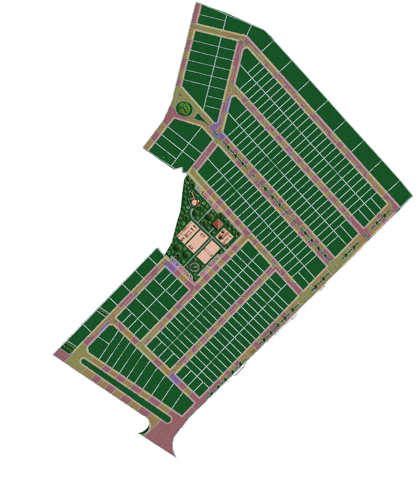

# Resumo

A Agenda de obras registra compromissos com data, horário, descrição e vínculo visual às áreas do loteamento. A seleção é feita diretamente sobre a planta: lotes, trechos de rua em frente aos lotes e a área social das quadras. O compromisso salvo aparece no dia escolhido e mantém as áreas associadas para consulta, edição ou remoção.

# Sumário

1. Agenda de obras e marcação de áreas na planta

# Capítulo 1 — Agenda de obras e marcação de áreas na planta

Abra o menu de navegação no canto superior direito e escolha **Agenda**. A agenda mostra o dia selecionado, os compromissos daquele dia e o calendário mensal. Para começar, use **Novo compromisso** ou **Adicionar compromisso** no dia desejado.

Informe o título e a data. Os horários de início e fim são opcionais; sem horário, o compromisso aparece como **Dia todo**. Use **Detalhes** para registrar equipe, materiais, instruções ou contexto. A data pode ser passada quando o registro do compromisso precisar ser retroativo.

Na seção **Áreas do loteamento**, toque ou clique na planta para marcar as regiões relacionadas ao serviço. A legenda diferencia os três tipos. O contador mostra quantas áreas foram selecionadas; as etiquetas abaixo da planta identificam cada uma e permitem removê-la pelo botão **×** enquanto o compromisso está em edição.

Um lote é selecionado tocando dentro de seu polígono. Cada fatia de rua representa a frente de um lote, para que o serviço viário possa ser localizado por trecho. Lotes de esquina podem ter mais de uma frente, registrada em segmentos separados. A área social é um polígono único que acompanha os limites das quadras e das ruas que a contornam.

No celular, use dois dedos para aproximar ou afastar a planta e arraste com um dedo para percorrê-la. No desktop, mantenha **Ctrl** pressionado enquanto arrasta verticalmente para aproximar ou afastar; **Ctrl + roda do mouse** também ajusta o zoom. **Enquadrar planta** retorna à visão completa e preserva as áreas já marcadas.

Confira título, data, detalhes e contador de áreas antes de salvar. **Salvar compromisso** fecha o formulário e mostra o novo cartão no dia escolhido. Abra o cartão para conferir descrição e áreas vinculadas. Em **Editar compromisso**, é possível alterar os campos e as marcações; **Excluir** remove o compromisso da agenda.

Os destaques de progresso no mapa usam os trechos e lotes associados aos compromissos da agenda. Assim, marcar um compromisso em uma área também deixa explícito onde o serviço deve ocorrer; para registrar um serviço já executado, informe a data correspondente e mantenha a área correta vinculada.
